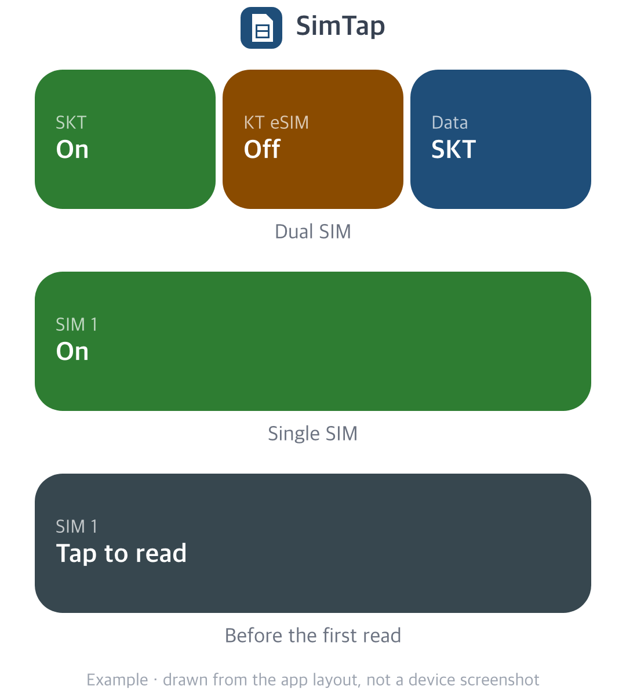

# SimTap

**English** · [한국어](README.ko.md)

**Turn SIM lines on or off from the Samsung Galaxy home screen with one tap.**

Turning off a work line after hours or a travel eSIM between trips means going to Settings > Connections > SIM manager every time. SimTap puts those switches in a home screen widget (4x1 or 5x1) that shows whether each line is on or off and switches it with one tap.

## What it does

- **Two line cells.** Shows up to two lines from the top of the SIM manager by their SIM names. Physical SIMs and eSIMs both work.
- **Data SIM cell.** Shows the SIM used for mobile data and opens the Mobile data picker. It appears on a dual SIM phone. With known states and fewer than two SIMs on it is dimmed and shows Needs 2 SIMs; unknown line states show Unknown instead.
- **5x1 widget with Wi-Fi and Data cells.** A second widget adds Wi-Fi and Data (mobile data on or off) between the line cells and Data SIM. Tapping opens the system internet panel. With a running accessibility service and known state, SimTap taps the appropriate switch once and waits for the requested state. Mobile data turning off is confirmed once only when the title, message and buttons match the installed SystemUI resources, in the first dialog within five seconds of that switch tap. Unrecognized dialogs are left to you. Wi-Fi turning on waits briefly for a connection before closing the panel; on timeout it leaves the panel open. Choose a Wi-Fi network there if needed. Unknown state or an unavailable service opens the panel without automatic clicks. The cells show On or Off when readable, otherwise Open.
- **Plain confirmation dialogs are confirmed for you.** Tapping a cell already says you want that line on or off, so SimTap taps OK once on a confirmation whose title has the SIM name. A turn-off dialog is confirmed whatever its message says, including notes that mobile data moves to the other SIM, that this is the last SIM, or that an MMS is being sent or received.
- **Risky dialogs are left to you.** SimTap does not tap a turn-on dialog that carries message text, such as one that turns other SIMs off or an eSIM security warning, a three-button dialog, or the eSIM reset screen.
- **Returns to the home screen** when the switch finishes. After a dialog is confirmed it waits up to three minutes for slow eSIM changes.
- **Stops when unsure.** If no switch has the SIM name the widget showed, SimTap taps nothing and tells you.
- **Reads again after reconnecting.** Service disconnect or reconnect invalidates SIM on/off states while keeping names. A cold process also treats persisted states as unknown. Line cells show Tap to read and the main screen shows Unknown until the manager is read again. Tapping an unknown or stale line cell only reads; tap again after the state appears to switch it.

## Install

1. Turn off Auto Blocker (Settings > Security and privacy) and Play Protect app scanning for a moment. Either one blocks the install. Turn them back on afterwards.
2. Download the APK from [Releases](https://github.com/tapbros/simtap/releases/latest) and install it.
3. Open SimTap and turn it on under Open Accessibility settings. If it is greyed out, tap App info > ⋮ > Allow restricted settings first. If that menu item is missing, try turning SimTap on in Accessibility once and it appears.
4. Long-press an empty area of the home screen, open Widgets > SimTap and place the 4x1 or the 5x1 widget.
5. Tap Read current state or the widget cell that says Tap to read. The widget then shows SIM names and states.

To update, install the new APK over the old one. Widgets and settings stay.

## How it works

Normal apps cannot turn SIMs on or off (`MODIFY_PHONE_STATE` is a system permission). When you tap the widget, SimTap opens the SIM manager and its accessibility service taps the switch for you, the same way you would. One UI shows its usual dialogs.

## Security

- Zero requested permissions and no internet permission.
- The accessibility service normally reads only SIM manager (`com.samsung.android.app.telephonyui`). During a Wi-Fi or Data task it temporarily includes SystemUI (`com.android.systemui`), then restores the SIM-only scope on completion, cancellation or timeout. It clicks internet panel controls and only a positively identified mobile-data-off confirmation. It does not confirm other SystemUI dialogs.
- It taps a switch only after you tap the widget. Opening the SIM manager yourself only lets SimTap remember SIM names and states.

## Tested devices and limits

- Galaxy Z Fold8, One UI 9.0 with one physical SIM, cover and main screens.
- Dual SIM (SIM plus eSIM, several eSIMs, two physical SIMs) was checked against a test app that mimics the SIM manager. If it fails on a real dual SIM phone, please report the model and One UI version.
- Up to two line cells. With three or more eSIM profiles only the top two appear.
- The Data SIM cell finds the Mobile data row of the SIM manager only when the system language is Korean or English. The Wi-Fi and Data cells of the 5x1 widget do not depend on the language.
- The Wi-Fi and Data cells of the 5x1 widget have not been checked on a device yet. On a model that does not let apps read those settings they show Open instead of On or Off.
- Device entries above describe earlier testing, not verification of these reliability changes. These changes require new phone checks before a stable release.

SimTap is a sibling app of [ShieldTap](https://github.com/tapbros/shieldtap). It is an unofficial app and is not affiliated with Samsung Electronics.

## License

Apache License 2.0. See [LICENSE](LICENSE) and [NOTICE](NOTICE).

© 2026 tapbros
